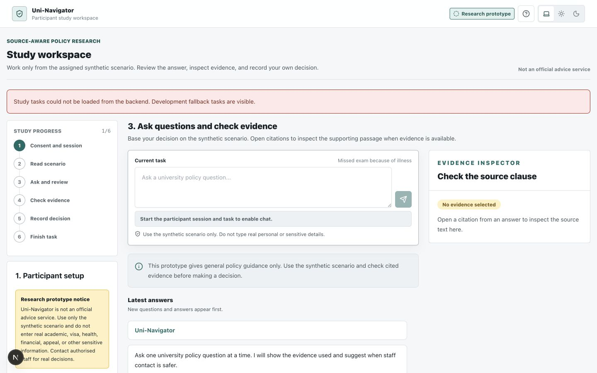

# Uni-Navigator: White Frontend Snapshot

This is snapshot 1 of a curated, two-snapshot showcase, prepared on 18 October
2026. It is not the original development commit history. The original private
research repository and its records are preserved separately.

## Preserved Version

The frontend comes from `uni-navigator-research-workbench-2026-08-03.tar.gz`,
SHA-256 `8933bf8a6e4164a9fd4b34240d497d7885a99bf1f0346a0f9551029a9a3cb2cd`.
The archive was preserved on 3 August 2026; this date is not a claim about the
first implementation date or the timing of participant feedback.

The white Research Workbench has a dedicated `/study` workspace, task steps,
an evidence panel, a condition selector, and in-app decision forms. Its archived
alternative `legacy` presentation is also present. Use the environment setting
below to select the white presentation explicitly.



## View The Historical Interface

Use Node.js 22 or newer and pnpm 11.2.2:

```bash
cd frontend
pnpm install --frozen-lockfile
NEXT_PUBLIC_UI_THEME=research_workbench NEXT_PUBLIC_STUDY_MODE=development NEXT_PUBLIC_API_BASE_URL=http://127.0.0.1:9 pnpm dev --port 3002
```

Open `http://localhost:3002/study` and use light appearance for the white view.
The deliberately unavailable API prevents this historical preview from writing
to a current research database. Backend-dependent controls will report errors.

This snapshot contains only the archived frontend. A matching historical backend
was not included in the archive; no later backend has been added retroactively.
It is a visual and code reference, not a runnable end-to-end historical study.

The archived frontend tests yield 19 passes and one failure: the historical
answer-package binding test needs `data/study/experimental_conditions.json`,
which was not in the frontend archive. The missing fixture is not replaced with
modern research configuration. This limitation belongs to snapshot 1 only.

## Publication Boundary

- Application source and fixture screenshots are preserved.
- Machine-specific editor settings and macOS archive metadata are omitted.
- This root README is a publication note added now; the archived frontend README
  is historical, and its machine-specific commands are not portable setup instructions.
- No API keys, participant data, databases, recordings or policy PDFs are included.
- No open-source licence is granted by this repository. Third-party dependencies
  retain their own licences. This is not an official university service.

Snapshot 2 replaces this frontend with the current research prototype and adds
its backend, tests, technical evaluation inputs and operating documentation.
