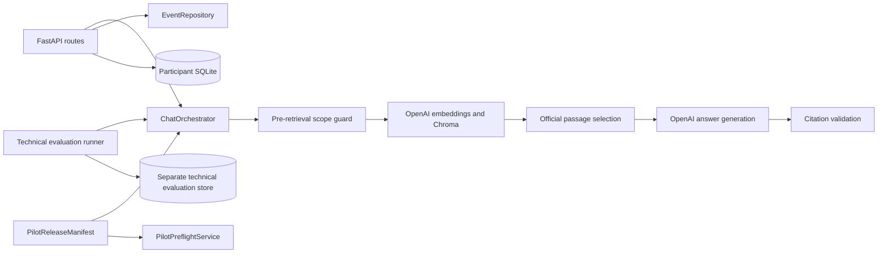

# Uni-Navigator Architecture

Uni-Navigator uses one source-aware live RAG path for development, self-testing, technical evaluation, and the backend participant runtime. Execution context changes provenance and research-data handling, not answer generation. The current frontend uses `/chat` with optional researcher-controlled sessions, as described in [pilot_runbook.md](pilot_runbook.md).

## Composition Root

`backend/app/core/container.py` constructs one lightweight application container at FastAPI startup. It owns the non-secret `RuntimeConfigSnapshot`, `ProviderRegistry`, condition and release services, `EventRepository`, the live answer strategy, and `ChatOrchestrator`.

Container construction failure does not make readiness diagnostics disappear. The API can still expose preflight status, while participant activation fails closed.

## Execution Contexts

- `development`: uses the live RAG pipeline. Interaction rows are marked as development and are not formal participant data.
- `participant_study`: uses the same live RAG pipeline and requires an active session and validated release/presentation context. The Chat workflow supplies a session ID; the backend derives its participant and presentation. It does not require an assigned task. Legacy task sessions retain their task guards.
- `technical_evaluation`: `live_llm` runs use explicit generation and retrieval settings in a separate repository. They are excluded from participant CSVs.

## Presentation architecture

The current participant-facing interface is `frontend/components/chat/ChatShell.tsx`, with one evidence presentation. `/study`, the A/B/C/D selector, and the task/trust/final-decision controls have been removed. See [study_flow.md](study_flow.md).

`frontend/lib/uiThemePolicy.mjs` resolves `NEXT_PUBLIC_UI_THEME` to `legacy` or `research_workbench`; invalid or absent values resolve to legacy. Theme styling does not change the RAG pipeline or research provenance. The former condition visibility module has been removed. `/design-lab` is a development-only fixture surface with no application API dependency; historical task examples there are not current research requirements.

## Stable Boundaries

`ChatOrchestrator` has no FastAPI or SQLModel query dependency and does not construct provider clients. It performs the scope check, official retrieval, generation, and citation validation for every chat request. Provider or retrieval failure never produces a fallback answer.

The `AssistantAnswer` response stays explicit and source-aware. Participant interaction provenance records the complete answer and citations, ordered chunk rankings and scores, requested and returned model snapshots, provider response ID, token usage, prompt and generation settings, retrieval configuration, corpus and scope fingerprints, condition, release, app revision, response time, and the non-secret runtime fingerprint.

The formal participant backend contract revalidates the frozen release checksum, condition checksum, current vector/corpus/scope binding, and the session runtime fingerprint before retrieval. A changed component blocks the request instead of mixing configurations within one Pilot round. Chat session activation also rejects a round whose previous sessions use a different runtime fingerprint.

## Data Evolution and Current Limits

Preserve existing research records while simplifying active workflows. Necessary schema changes may use a verified non-destructive migration; old executable paths need not be retained when no active consumer requires them. Historical session and task records remain available for analysis.

`chat_session_service.py` validates session ownership of interactions/citations and derives participant identity on the server. Existing session metadata stores `workflow=chat`, `roundId`, and the real execution context without changing the database schema. Client writes use stable operation IDs with transactional receipts in `StudyEventLog`; retries cannot duplicate evidence or feedback records. A per-tab queue retains failed writes until acknowledgement. Ending a session flushes this queue first. The three filtered research exports reuse existing tables without duplicating evidence events in the timeline.

Full event sourcing, public authentication, and a generic workflow framework are not requirements of the current local study. Admin remains local-only; participant codes are pseudonyms, not authentication credentials.
